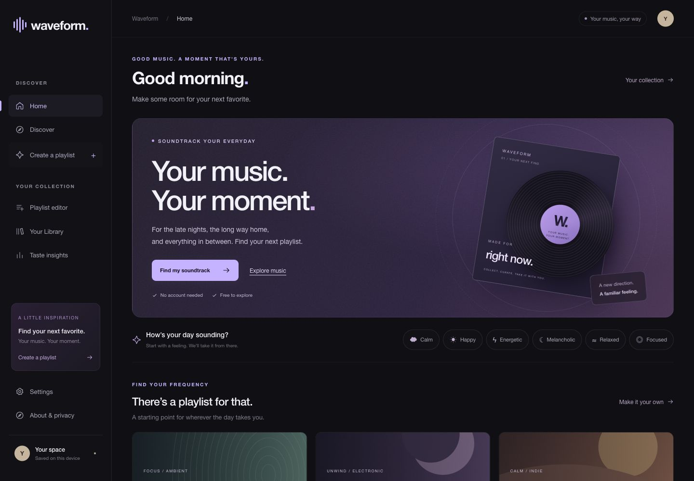
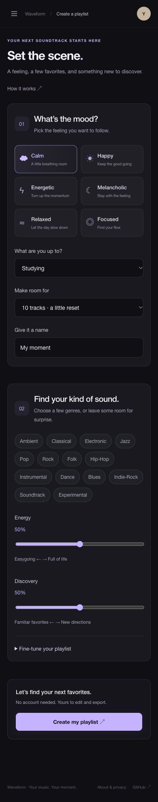

<p align="center"></p>

<p align="center">A playlist for the way you feel. Discover something new, make it yours, and take it with you.</p>

<p align="center">
  <a href="https://github.com/jayanthwritescode/Waveform/actions/workflows/quality.yml"></a>
  · <a href="#run-locally">Run locally</a>
  · <a href="docs/DEPLOYMENT.md">Deploy</a>
  · <a href="SUPPORT.md">Get help</a>
</p>



## Find your frequency

For the deep-work session. The late-night reset. The long way home. Waveform turns a little context into a playlist you can make your own.

| Set the scene | Make it yours | Take it with you |
| --- | --- | --- |
| Choose a mood, activity, genres and a few favorites. Search real recordings on MusicBrainz. | Replace, remove and rearrange tracks. See why a discovery fits. Save the mixes you love. | Download CSV or a simple tracklist, find songs on your music service, or keep a full JSON backup. |

**No account. No subscription. Your collection stays on your device.**

- **Live discovery:** songs, artists and genre/tag searches through the official MusicBrainz API.
- **Personal playlists:** six moods, seven activities, 10/20/30-track mixes, adjustable discovery and optional fine-tuning.
- **A collection that travels:** playlist files plus full-library backup/restore. Conflicting versions restore as separate copies.
- **Room for a second thought:** track replacement, drag or keyboard ordering, and Undo for removing/clearing draft tracks.
- **Ready when the connection isn’t:** a credited 208-track offline collection and cached app shell after a successful production visit.
- **Made for everyday use:** responsive layouts, keyboard focus, reduced motion, honest source states and a built-in About & privacy guide.

<details>
<summary>See the mobile playlist studio</summary>
<br>

</details>

## Run locally

Use **Node.js 22 or 24**. There are no package dependencies to install.

```sh
git clone https://github.com/jayanthwritescode/Waveform.git
cd Waveform
npm run dev
```

Open **http://127.0.0.1:5173**. No Python server, database, API key or environment configuration is required.

```sh
npm test          # Active JavaScript tests
npm run build    # Generate the static dist/ artifact
npm run verify   # Validate public files and exclusions
npm run preview  # Production preview at http://127.0.0.1:4173
```

Development serves only `frontend/`. Publish only `dist/`; the repository root contains historical code and private local-data paths that are outside the application.

## Make a playlist

1. Open **Create a playlist** and choose a feeling and an activity.
2. Select genres or leave room for surprise. Adjust energy/discovery; optional fine-tuning lives behind one disclosure.
3. Create your mix. Review the live, cached or offline source notice and explanations.
4. Select **Make it mine** to rename, replace, remove and arrange tracks in the editor.
5. Save to **Your Library**, export a playlist file, or follow the manual transfer instructions.

To move everything to another browser, go to **Settings → Download library backup**, then restore that file on the other device. Existing playlists are preserved. Preferences restore only when selected, and your current editor stays untouched.

## Deploy on a static host

Both Vercel and Netlify can build this project using their free plans, within the provider’s eligibility and usage limits.

| Setting | Value |
| --- | --- |
| Branch | `main` |
| Root directory | Repository root |
| Build command | `node tools/build.mjs` |
| Output / publish directory | `dist` |
| Framework preset | Other / static |
| Environment variables | None |

`vercel.json` and `netlify.toml` include the static build and security headers. No server functions or paid backend are needed. **A public application deployment has not been performed in this session.** See [deployment and HTTPS verification](docs/DEPLOYMENT.md) before sharing a hosted URL.

## Built with a little transparency

Waveform uses HTML, CSS and native JavaScript modules. A deterministic metadata ranker combines genres/tags, context and explicit preferences, then balances variety and artist repetition. Missing signals stay unknown; energy is a documented genre proxy, not audio analysis. There are no fabricated confidence percentages or listening statistics.

MusicBrainz supplies live recording metadata. The offline collection retains attribution to FMA and Kevin MacLeod / Incompetech; its metadata is CC BY 4.0. Illustrated covers are original Waveform artwork. No audio is hosted. See [sources, caching and API terms](docs/CATALOGUE.md) and the in-app credits.

Your playlists and preferences use localStorage, without cloud sync, advertising or built-in analytics. Music searches go directly to MusicBrainz; external search/transfer services have their own policies. Clearing site data can remove local saves, so keep a backup. CSV/TXT downloads and service links do not create streaming playlists automatically.

## Release checks

The active suite covers API scheduling/retries/failures, real fallback ranking, format round trips, local persistence, backup conflicts and safe undo. Browser review covers desktop/mobile, keyboard use, live discovery, playlist editing/export and cached offline use. GitHub Actions runs tests, build and artifact verification on Node 22 and 24.

[Product QA](docs/PRODUCT_QA.md) · [Architecture](docs/ARCHITECTURE.md) · [Recommendation model](docs/RECOMMENDATION_MODEL.md) · [File formats](docs/FILE_FORMATS.md)

## Project

[Changelog](CHANGELOG.md) · [Contributing](CONTRIBUTING.md) · [Support](SUPPORT.md) · [Report an issue](https://github.com/jayanthwritescode/Waveform/issues/new/choose)

The earlier full-stack application and research are preserved under `legacy/` and `docs/history/`, excluded from the deployed app. Original source datasets, private database, audio and fitted artifacts remain untouched in root `data/`.
